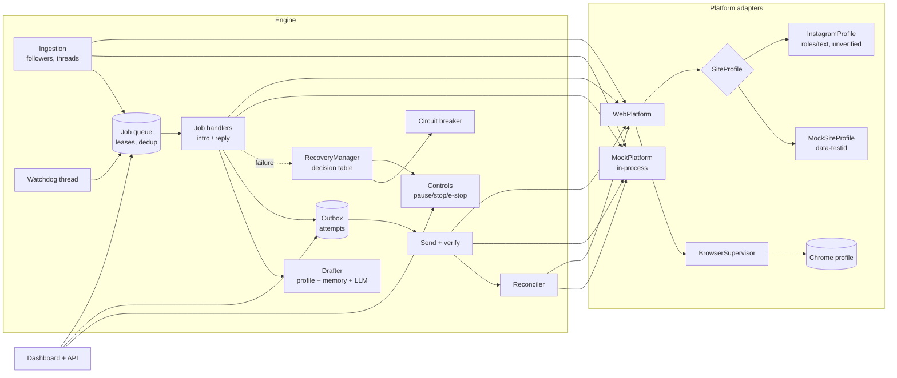

# Architecture

## Convo 5 (the `assistant` package)

The Mac app runs `assistant` (FastAPI on 127.0.0.1:8765) with the Command Centre (React, `web/` built into
`assistant/web/dist`). Modules:

| Module | What it does |
|---|---|
| `app.py` | The API, settings, the sender and background loop (overnight writing, reminders, due posts, platform syncs) |
| `store.py` | SQLite with numbered migrations; a full backup before any migration runs on a real database |
| `hub.py` | Dashboard, conversations, accounts, groups, analytics, automations |
| `followups.py` | Waiting on you, hellos with no reply, your reminders (never people Convo mustn't contact) |
| `content.py` | Posts, files in `data/library/`, signed media links, captions, schedule, due notifications |
| `connect/` | OAuth (PKCE, one-time state) with Luke's own apps; YouTube, Instagram and TikTok; keys in `data/integrations/` (0600) |
| `growth.py` | Missions, goals, the Organic Independence Score, launch mode, collaborations |
| `engagement.py` | Comments and replies (sent only on Send) |
| `phone.py` | Optional listener on the Tailscale address |
| `updates.py` | Updates from GitHub releases with checksums, test start, backup, switch and undo |
| `ask.py` | Ask and the AI Strategist (tools; code-level safety on anything that sends) |

The older `agent` engine below still provides the browser, profile and LLM pieces Convo builds on.

## The original engine (`agent`)

A modular monolith: one process, one SQLite database, one worker thread for platform work, one watchdog thread,
and a FastAPI dashboard. Nothing in the business logic imports Playwright or an LLM SDK; those sit behind
interfaces and are injected in `agent/app.py`.

## Modules

| Package | Responsibility |
|---|---|
| `agent/core/config.py` | Pydantic settings (env `AGENT_*`), all policy knobs in one place |
| `agent/core/db.py` | SQLite connection, serialized access, explicit transactions, versioned migrations (`agent/migrations/*.sql`) |
| `agent/core/states.py` | Job, outbox and browser state machines with legal transitions |
| `agent/core/jobs.py` | Durable queue: dedup keys, atomic compare-and-set claims, leases, per-subject serialization, backpressure |
| `agent/core/errors.py` | Typed errors carrying an `ErrorCategory` |
| `agent/core/recovery.py` | Classification, backoff with jitter, circuit breaker, controls, deterministic `RecoveryManager.decide` |
| `agent/core/policy.py` | Pure policy functions: approval, send permission, intro eligibility, disengagement, age |
| `agent/core/observability.py` | JSON logs with redaction, counters |
| `agent/intel/profile.py` | Personality profile: facts with source/verification/shareability, style, samples, intro templates |
| `agent/intel/reasoning.py` | Context assembly, structured drafting, validation (facts, style, policy, injection) |
| `agent/intel/llm.py` | `LLMProvider` protocol; Anthropic provider (structured JSON output); deterministic `FakeLLM` |
| `agent/platform/base.py` | `PlatformAdapter` protocol, `Capabilities`, provenance-tagged observations |
| `agent/platform/mock.py` | Synthetic world with fault injection; direct adapter |
| `agent/platform/mock_site.py` | The same world as a website, so a real Chromium can be tested |
| `agent/platform/browser.py` | Browser lifecycle, health checks, bounded recovery, error translation, session/challenge detection |
| `agent/platform/sites.py` | Site profiles (locators, URL patterns, capability claims) |
| `agent/platform/web.py` | Browser-backed adapter |
| `agent/engine/engine.py` | Ingestion, job handlers, outbox, reconciliation, failure handling, watchdog, operator actions |
| `agent/engine/scheduler.py` | Worker and watchdog threads, single-instance lock |
| `agent/web/dashboard.py` | Operator API and dashboard |

## Separation of observation, reasoning, decision and action

1. **Observe**: adapters return `FollowerObservation` / `ThreadSnapshot`, each tagged `verified` or `inferred`.
2. **Reason**: `Drafter` returns a `DraftOutcome` (text, facts used, validation). A draft never implies permission to send.
3. **Decide**: `policy.can_send` plus approval state decide whether an outbox row is created approved, awaiting approval, or not at all.
4. **Act**: only `Engine._send` touches the platform's send, and only after committing the attempt and passing `Controls.guard` and `policy.assert_deliverable`.

## Data model

Tables (see `agent/migrations/0001_init.sql`): `accounts`, `follower_events`, `conversations`, `messages`, `jobs`,
`job_transitions`, `drafts`, `outbox`, `delivery_attempts`, `memory`, `journal`, `recovery_events`, `audit`,
`app_state`, `schema_version`. Identity and deduplication rely on unique constraints:
`accounts.platform_id` (when the platform exposes one), `accounts.username`, `follower_events.dedup_key`,
`messages(conversation_id, platform_message_id)`, `jobs.dedup_key`, `outbox.job_id`.

The spec's entity names map as: Account → `accounts`, Conversation → `conversations`, Message → `messages`,
FollowerEvent → `follower_events`, ProcessingJob → `jobs` (+ `job_transitions`), OutboundMessage → `outbox`,
DeliveryAttempt → `delivery_attempts`, ConversationMemory → `memory`, PersonalityProfile → `data/profile.json`
(a versioned, user-edited file rather than a table, so you can edit it directly), ResearchEntry → `journal`,
RecoveryEvent → `recovery_events`, AuditEvent → `audit`.

## Key decisions and trade-offs

* **One worker thread for platform work.** A single Chrome session gains nothing from concurrency, and serial
  processing keeps message order trivially correct. The queue still supports multiple workers safely
  (compare-and-set claims, per-subject serialization, leases), which the tests exercise.
* **SQLite with a process-level lock.** Simple, transactional, one file to back up. A file lock prevents two
  schedulers on one database.
* **Intros come from your own templates, not the model.** Wording you wrote, zero model cost, nothing invented.
  Replies use the model with a strict JSON schema and post-validation.
* **Inferred followers are baselined.** When a platform can only show the followers list, the first observation
  records everyone as existing followers instead of treating hundreds of people as "new".
* **Unknown exceptions are permanent, not transient.** Retrying something we don't understand is how duplicate
  side effects happen.
