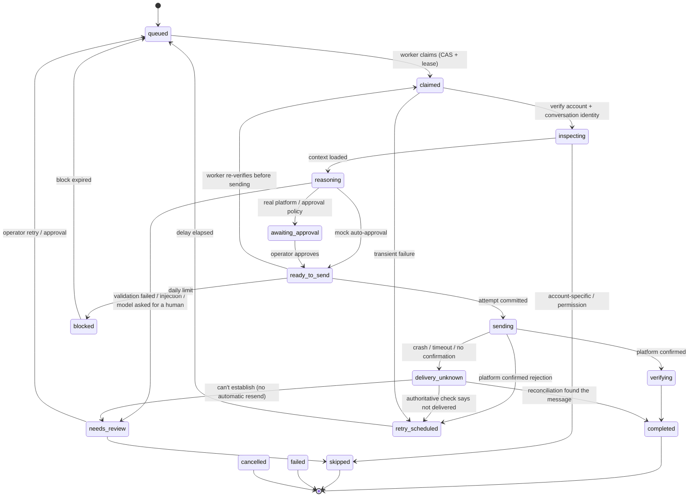
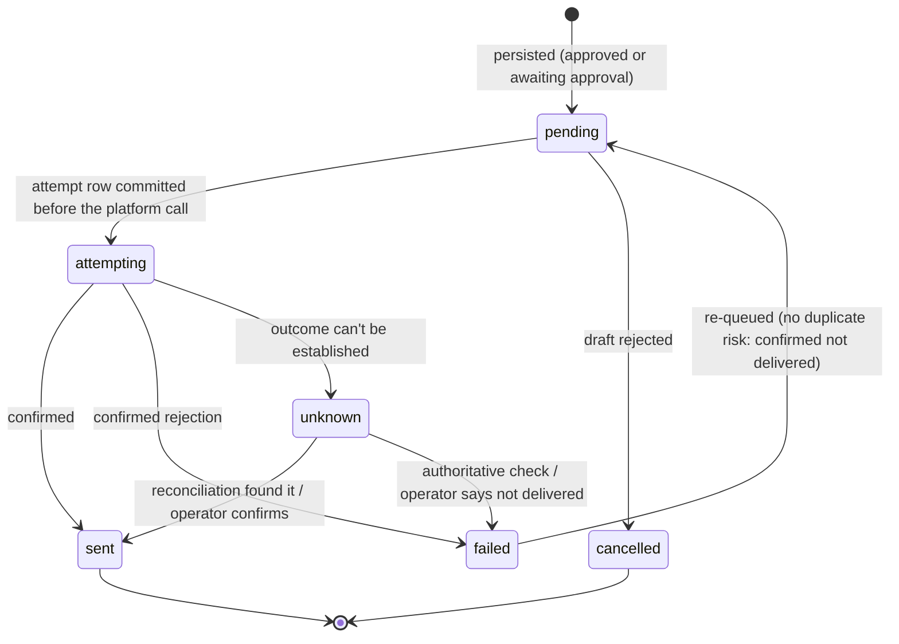
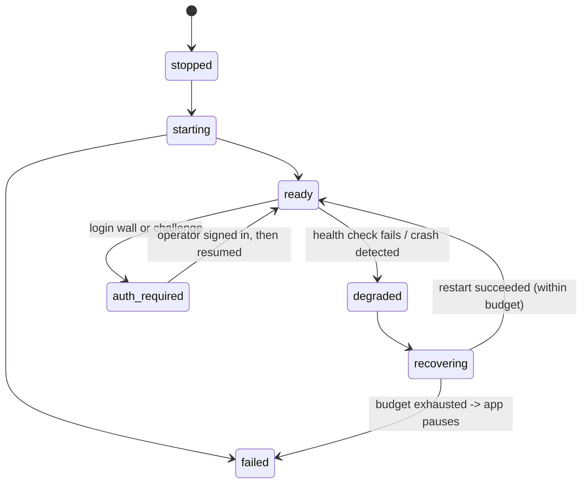

# State machines

All transitions are validated in code (`agent/core/states.py`); illegal transitions raise `DataIntegrityError`.
Every job transition is persisted in `job_transitions` with a reason.

## Processing job

Restart rules (`Engine.startup_recovery`):

| State at crash | After restart | Why |
|---|---|---|
| claimed, inspecting, reasoning | queued | no side effect has happened yet |
| sending, verifying | delivery_unknown | the send may have happened: reconcile, never resend blindly |
| outbox `attempting` | outbox `unknown`, attempt marked `unknown` | same |
| awaiting_approval, ready_to_send, retry_scheduled, blocked, needs_review | unchanged | already durable and safe |

Lease expiry (`JobQueue.recover_stale_leases`) applies the same rules while running; the watchdog forces lease
expiry for jobs with no progress for `stall_s`, in one state for `max_state_s`, or running longer than `max_job_s`.

## Outbound message (outbox)

`unknown` can never go back to `pending` directly: only through `failed`, which requires an authoritative check
or an explicit operator decision.

## Browser

## Conversation

`active` → `opted_out` (they asked to stop: permanent, no further contact) or `needs_review` (e.g. stated age
outside the allowed range). Opted-out conversations never get reply jobs; the account is never re-introduced.
